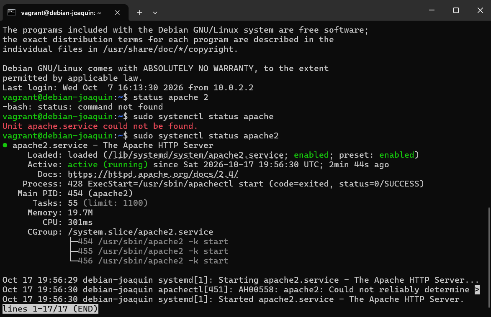

### Tarea 1.1.2 (Vagrant)

Por Joaquín Alejandro

## Sección A: Investigación

### Vagrant y el Vagrantfile
**¿Qué es Vagrant y por qué resulta útil? Distingue lo que lo forma, sobre Vagrantfile y su archivo al inicio y al final**

Citando textualmente "Vagrant es un software libre que crea una capa por encima de la virtualización", permite crear, actualizar, modificar y administrar entornos virtuales reproducibles mediante código o script reproducible y de forma automatizada en cualquier equipo. Resulta util al permitir replicar un entorno virtual exactamente igual con facilidad, siendo de facil transporte y sobre todo, funcional en cualquier tipo de manquina independientemente de su sistema operativo. Se pueden distinguir:

- El anfitrión: Es quien contiene todos los archivos, lee la configuración de 'Vagrantfile' y arranca los procesos, físicamente, es la computadora donde están dichos archivos.
- El proovedor: Tambien llamado "providers", son los programas de virtualización que ejecutan las máquinas, como VirtualBox (el predeterminado), VMware o Hyper-V.
- La Box: Son las imágenes base de las máquinas virtuales preconfiguradas con un sistema operativo.
- La Máquina virtual: Es el entorno simulado que se ejecuta de manera independiente. Cree tener su propio hardware, pero todo lo que hace es virtual.
- Vagrantfile: Es un archivo capaz de escribir el tipo de la máquina necesaria para un proyecto, y cómo configurarlo y Provisiona estas máquinas, esta escrita en codigo ruby

### Aprovisionamiento 
**Investiga qué es un provisioner, dónde se ejecuta el script, cuándo lo lanza Vagrant y qué diferencia hay entre inline: y path:. Explica qué ocurre si modificas el script después del primer vagrant up y cómo lo ejecutarías de nuevo.**

Un provisioner es un mecanismo que permite automatizar la instalación de software y la configuración de la máquina virtual (el invitado o guest), como parte del proceso de vagrant up y se usa para preparar un entorno, con el fin de que se use sin intervención manual. Este se ejecuta dentro de la máquina virtual (el invitado o guest). Para sistemas Linux, Vagrant utiliza SSH, para Windows, usa WinRM (PowerShell o Batch); igualmente, el provisioning se ejecuta durante el primer vagrant up que crea el entorno. Si la máquina ya existe, no se volverá a ejecutar.

Modificar el contenido de un script de cualquier manera generar cambios, más no se ejecutaran la próxima vez que ejecutes vagrant up o vagrant reload y para poder ejecutarlo se pueden realizar de dos maneras:
- Mediante 'vagrant provision' que aplica los provisioners a una maquina encendida, ejecutando los scripts de nuevo y aplicando las modificaciónes
- O mediante 'vagrant reload' --provision: que reinicia la máquina y fuerza la ejecución del provisioning al arrancar.

**Diferencia entre inline: y path:** Ambos son argumentos del provisioner de tipo shell, mientras inline especifica un comando o secuencia de comandos directamente en el Vagrantfile como una cadena de texto, path sin embargo, especifica la ruta a un archivo de script local (en tu host) que Vagrant subirá a la máquina virtual y luego ejecutará, siendo más complejo. 

### Interfaces y redes
**Investiga qué conexión de red configura Vagrant por defecto y para qué la utiliza. Averigua cómo se añade en el Vagrantfile una segunda interfaz con dirección IP fija. Compara NAT, red interna, red privada host-only y red pública: explica con quién puede comunicarse la máquina en cada caso y qué función cumple el reenvío de puertos.**

Vagrant, por defecto, configura la primera red (eth0) como NAT, garantizando que se pueda conectar a la maquina virtual y la usa principalmente para establecer conexiones SSH y reenvio de puertos. Para añadir una segunda interfaz de red con una dirección IP estática, se utiliza la configuración 'private_network' en el Vagrantfile. Esto crea típicamente una red host-only, permitiendo la comunicación directa entre el host y la VM.

El reenvío de puertos permite acceder a un puerto de la máquina virtual (guest) a través de un puerto de la máquina host. El tráfico que llega a un puerto específico del host se redirige automáticamente al puerto correspondiente en la VM, es la que nos permite acceder a los servicios que se ejecutan dentro de la VM (como un servidor web) desde el navegador del host. 

Por ejemplo, con la configuración mostrada a continuación significa que el puerto 8080 del Host reenviaria su puerto al puerto 80 de la Maquia virtual en la 127.0.0.1 

```cmd
config.vm.network "forwarded_port", guest: 80, host: 8080, host_ip: "127.0.0.1"
```

### Órdenes y carpeta compartida. 
**En una tabla breve, indica cuándo usarías up, status, ssh, reload, provision, halt y destroy; marca cuáles llegaste a ejecutar. Averigua qué es /vagrant y comprueba qué archivos aparecen allí.**

| Comando a usar | Cuando se deberian usarse | ¿Las he utilizado? |
| --- | --- | --- |
| ```up``` | Se usaria si queremos a la vez, crear y arrancar una máquina virtual | si |
| ```status``` | Se usaría si queremos saber el estado actual de la maquinas | si |
| ```ssh``` | Se usaria para conectarse a una maquina virtual mediante SSH | no |
| ```reload``` | Se usaría si hemos hecho cambios y queremos aplicar la configuración y los cambios realizados | no |
| ```provision``` | Si existe el provisionamiento de una VM ya existente que queramos usar, este comando se encarga de aplicarlo a la máquina | no |
| ```halt``` | Como sirve para detener la maquina virtual (sin destruirla), sirve para eso mismo| si |
| ```destroy``` | Se usa si se quiere detener y eliminar la máquina virtual correspondiente | no |


## Sección B: Practica

### Presenta un esquema de la arquitectura con sus dos interfaces


### Describe la configuración del "Vagrantfile" y cuenta cómo has preparado Apache.

```
Vagrant.configure("2") do |config|
  config.vm.box = "debian/bookworm64"
  config.vm.hostname = "debian-joaquin"

  # Reenvío de puerto 8080 del Host al 80 de la VM en 127.0.0.1
  config.vm.network "forwarded_port", guest: 80, host: 8080, host_ip: "127.0.0.1"

  # Red privada (VirtualBox la crea como Red Interna / Host-Only)
  config.vm.network "private_network", ip: "192.168.56.10"

  config.vm.provider "virtualbox" do |vb|
    vb.name = "VM-Debian-joaquin"
    vb.memory = "1024"
    vb.cpus = 1
  end

  config.vm.provision "shell", path: "setup.sh"
end
```

Este código es el encargado en configurar la maquina virtual (Vagrantfile), podemos distinguir las configuraciones:
- config.vm.box	especifica la imagen base a utilizar
- config.vm.hostname	especifica el nombre del usuario
- config.vm.network mapea un puerto del guest al host para acceder a servicios, dependiendo si se pone "forwarded_port" (Indicando el puerto y red del host a reenviar) o "private_network" (La red interna)
- config.vm.synced_folder	sincroniza una carpeta local con una ruta en la VM 
- config.vm.provision ejecuta un script durante el aprovisionamiento, en el lenguaje indicado (en este caso shell)
- config.vm.provider configura parámetros específicos del proveedor, la maquina virtual (en este caso virtualbox)

Normalmente usaríamos ```vagrant init```para generar un Vagrantfile con configuración estándar, sin embargo, como ya hemos creado Vagrantfile podemos ejecutar ```vagrant up``` de una, ya que leera automaticamente el Vagrantfile ya creado, realizando las configuraciones pertinentes.

```
#!/usr/bin/env bash
set -e

apt-get update -y
apt-get install -y apache2

systemctl enable apache2
systemctl start apache2

HOSTNAME=$(hostname)
cat <<EOF > /var/www/html/index.html
<!DOCTYPE html>
<html lang="es">
<head>
    <meta charset="UTF-8">
    <title>Entorno Vagrant - Apache</title>
</head>
<body>
    <h1>Servidor Apache de Aprovisionamiento</h1>
    <p><strong>Estudiante / Desarrollador:</strong> JOAQUIN</p>
    <p><strong>Hostname de la VM:</strong> ${HOSTNAME}</p>
</body>
</html>
EOF
```
Este código es el encargado en configurar el script de aprovisionamiento de Apache (setup.sh), su configuración indica que queremos el script ejecutado en bash, que actualice los paquetes disponibles e instale apache 2 sin confirmar. El texto consecuente dentro esta la página web sencilla que he sido mandado a crear, mostrando un mensaje indicando que si es el Servidor Apache de Aprovisionamiento, quien es el estudiante o desarrollador (es decir, yo) y que el hostname de la máquina virtual es (obviamente) el hostname usado dentro de la maquina vagrant, finalizando con EOF (End Of File) que indica el final de este archivo setup.sh.

Esta preparación de apache fue pensada para no solo instalar, pero también crear una pagina web que demuestre que el server es funcional.

### Capturas de pantalla con el servidor Apache
Añade capturas de pantalla insertadas en el documento que permitan apreciar que el servidor Apache está en ejecución dentro de la máquina y que se puede acceder a su página desde el anfitrión. Elige las capturas que mejor respalden tu explicación y comenta qué muestran.



Aquí podemos ver el status actual del servidor HTTP de Apache


Y aquí podemos ver el texto de la página web creada en setup.sh, probando que el servidor esta activo.


Aquí indico la redes dentro del equipo, no es nada interesante pero igualmente lo pongo

## Bibliografía:

- Vagrant: https://www.arsys.es/blog/entorno-desarrollo-vagrant
- Las fotos utilizadas estan situadas en la carpeta fotosreferencia
